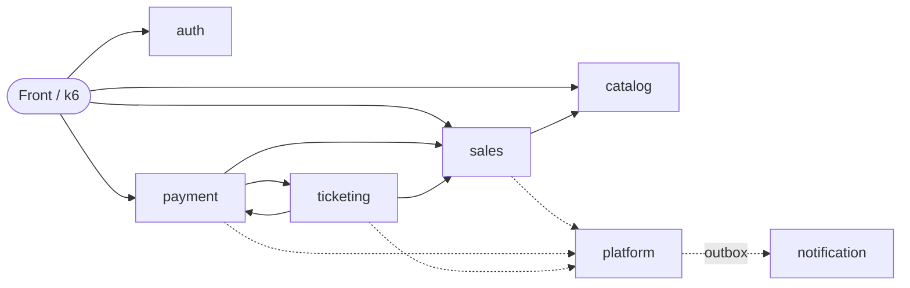

# Ticketing Platform


Plataforma de venda de ingressos por lotes, construída como **monólito modular** em Java e Spring Boot, projetada para sustentar alta concorrência sem vender um ingresso a mais do que existe e sem cobrar duas vezes.

O projeto foi planejado antes de ser codificado: cada decisão técnica nasce de uma regra de negócio ou de uma medição, e o resultado final será implantado na AWS, submetido a teste de carga e publicado com os números.

> **Status:** em desenvolvimento. A fundação está concluída; os módulos de negócio estão sendo implementados fase a fase. Veja o [roadmap](#roadmap).

## Sumário

- [Problema e objetivos](#problema-e-objetivos)
- [Arquitetura](#arquitetura)
- [Decisões técnicas em destaque](#decisões-técnicas-em-destaque)
- [Stack](#stack)
- [Como executar](#como-executar)
- [Testes](#testes)
- [Estrutura do projeto](#estrutura-do-projeto)
- [Documentação](#documentação)
- [Roadmap](#roadmap)
- [Autor](#autor)

## Problema e objetivos

Vender ingressos é um problema de concorrência clássico: milhares de pessoas disputam poucas unidades ao mesmo tempo, o pagamento é assíncrono e qualquer falha no meio do caminho não pode deixar estoque preso nem dinheiro sem ingresso.

Metas de projeto (a serem **medidas**, não assumidas):

| Meta | Valor |
| --- | --- |
| Usuários simultâneos no teste | 5.000 |
| Ingressos disputados | 10.000 |
| Vazão | 200 a 500 requisições por segundo |
| Latência p95 (leituras) | abaixo de 200 ms |
| Latência p95 (reservar e pagar) | abaixo de 500 ms |
| Venda acima do estoque | zero |
| Cobrança duplicada | zero |
| Taxa de erro | abaixo de 1% |

Fluxo principal: o organizador cria o evento e seus lotes, o comprador reserva por tempo limitado, paga (com confirmação assíncrona por webhook), recebe os ingressos e pode cancelar dentro das regras. Falhas e atrasos geram estorno automático.

## Arquitetura

Um único deploy, dividido em oito módulos com fronteiras explícitas. Cada módulo expõe um pacote `api` (o que os outros podem chamar) e esconde o resto em `internal`.



| Módulo | Responsabilidade |
| --- | --- |
| `auth` | cadastro, login, tokens, confirmação de e-mail, papéis |
| `catalog` | eventos, lotes, categorias, estados e cidades, listagem e busca |
| `sales` | reserva, contador por conta, expiração, estoque do lote |
| `payment` | pagamento, webhook, conciliação, estorno, gateway simulado |
| `ticketing` | ingressos, cancelamentos, nota fiscal |
| `notification` | avisos no app e e-mail |
| `platform` | outbox, idempotência, limite de requisições, configuração |
| `observability` | métricas técnicas e de negócio |

As fronteiras não são convenção: um teste de arquitetura (**ArchUnit**) roda no build e falha se um módulo importar o interior de outro ou criar uma dependência não prevista. Consequências do módulo (nota fiscal, notificações, estornos em massa) passam por um **outbox transacional**, que é também a ponte para extrair módulos e adotar mensageria (Kafka) no futuro.

## Decisões técnicas em destaque

- **Concorrência sem venda a mais.** A reserva usa atualizações condicionais atômicas no banco ("mude apenas se a condição ainda vale", usando o número de linhas afetadas). Cinco estratégias serão comparadas com carga real: ingênua, pessimista, otimista, atualização condicional e Redis. A escolha final será registrada com os números.
- **Sem deadlock.** Ordem global de travas em todos os caminhos: contador da conta, reserva ou ingresso e, por último, o lote (a linha mais disputada).
- **Idempotência.** Cada operação nova carrega uma chave gerada pelo cliente. Repetir a requisição devolve o resultado guardado em vez de executar de novo.
- **Pagamento assíncrono.** Gateway simulado com webhook assinado, deduplicação por identificador do evento, tratamento de eventos fora de ordem, conciliação periódica e estorno automático de aprovações tardias.
- **Consistência de consequências.** Outbox com tentativas e intervalo crescente, execução concorrente segura (`FOR UPDATE SKIP LOCKED`) e tratadores idempotentes.
- **Tempo confiável.** Todas as condições de tempo (expiração de reserva, janela de venda) usam o relógio do banco, nunca o da aplicação.
- **Máquinas de estados explícitas** para reserva, pagamento, estorno, ingresso, lote e evento, documentadas em [`docs/`](docs/).
- **Dados pessoais protegidos.** CPF cifrado com AES-GCM e índice cego (HMAC) para unicidade; segredos fora do Git (variáveis de ambiente localmente, Parameter Store na AWS).
- **Medir antes de otimizar.** Índices de listagem só entram depois da análise de planos de consulta.

## Stack

Na base atual:

- Java 25 e Spring Boot 4.1
- Spring Web MVC, Spring Security (Resource Server com JWT), Spring Data JPA e Hibernate
- PostgreSQL 17 e Flyway (migrações versionadas)
- JUnit, Testcontainers e ArchUnit
- Spring Boot Actuator e Micrometer (métricas no formato Prometheus), em porta de gestão separada
- Docker Compose e GitHub Actions (CI)

Nas próximas fases:

- Prometheus e Grafana (painéis versionados no repositório)
- k6 para testes de carga
- Redis (estratégia de estoque em cache)
- AWS: EC2, RDS PostgreSQL, S3, Parameter Store e, opcionalmente, ALB com duas instâncias

## Como executar

Pré-requisitos: **JDK 25** e **Docker** com Docker Compose.

```bash
# 1. Variáveis de ambiente locais
cp .env.example .env
# preencha POSTGRES_DB, POSTGRES_USER e POSTGRES_PASSWORD

# 2. Banco de dados
docker compose up -d
docker compose ps        # aguarde o estado "healthy"

# 3. Aplicação
./mvnw spring-boot:run
```

| Porta | Serviço |
| --- | --- |
| 8080 | API |
| 8081 | Actuator (`/actuator/health`, `/actuator/prometheus`) |
| 5433 | PostgreSQL local (no host) |

A porta de gestão (8081) é separada de propósito: na AWS ela não será exposta ao público. Para apontar a aplicação para um banco em outra máquina, defina `DB_HOST` e `DB_PORT` no `.env`.

## Testes

```bash
./mvnw verify
```

Roda a suíte completa e exige Docker, pois os testes de integração sobem um PostgreSQL real e descartável com Testcontainers (a mesma versão usada no Compose). Para executar uma classe de teste isolada, sem Docker:

```bash
./mvnw test -Dtest=ArchitectureTest
```

A integração contínua executa `./mvnw verify` a cada push e pull request.

## Estrutura do projeto

```
src/main/java/dev/obrenoxs/ticketing
├── auth/            # cada módulo tem:
├── catalog/         #   api/       contrato público para outros módulos
├── sales/           #   internal/  implementação (web, service, repository, domain)
├── payment/
├── ticketing/
├── notification/
├── platform/
└── observability/
src/main/resources/db/migration   # migrações do Flyway
docs/                             # regras de negócio, modelo de dados e arquitetura
```

## Documentação

- [Regras de negócio e decisões](docs/business-rules.md)
- [Modelo de dados (DBML)](docs/ticketing-model.dbml), importável no [dbdiagram.io](https://dbdiagram.io)
- [Diagramas de arquitetura](docs/architecture/)
- [Fluxo de Git](docs/git-workflow.md)
- [Módulo `platform`: o que está implementado](docs/platform.md)

## Roadmap

- [x] Fundação: projeto, banco, migrações, testes, tratamento de erros, segurança provisória, CI
- [x] `platform` (parte 1): configuração tipada, ids UUID v7, relógio do banco, limite de requisições, `X-Request-Id` e cache com TTL macio e duro
- [ ] `platform` (parte 2): idempotência e outbox
- [ ] `auth`: cadastro, login, tokens, papéis
- [ ] `catalog`: eventos, lotes e leitura pública
- [ ] `sales`: reserva (versão ingênua como linha de base)
- [ ] `payment` e `ticketing`: pagamento assíncrono, estorno, cancelamentos, nota fiscal
- [ ] `notification` e `observability`: avisos, métricas e painéis
- [ ] Medição: comparação das estratégias de concorrência com k6
- [ ] AWS: implantação, teste de carga, resultados publicados e desligamento

Os resultados dos testes de carga serão publicados em `docs/benchmarks/` ao final das fases de medição.

## Autor

**Breno Oliveira de Souza**, desenvolvedor backend Java.

- GitHub: [@obrenoxs](https://github.com/obrenoxs)
- LinkedIn: [Breno Souza](https://www.linkedin.com/in/breno-oliveira-souza/)
